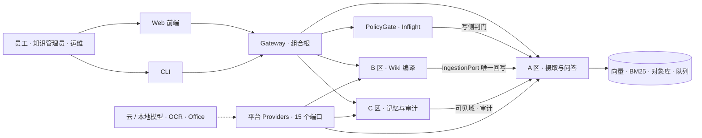
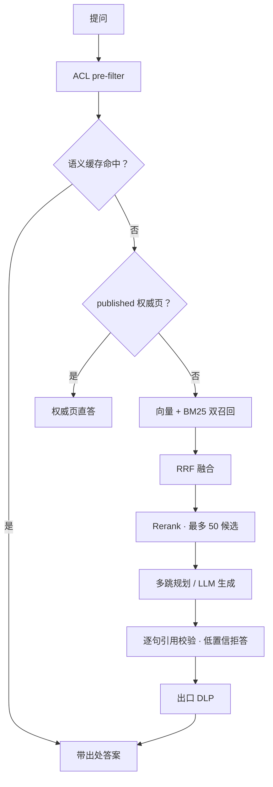
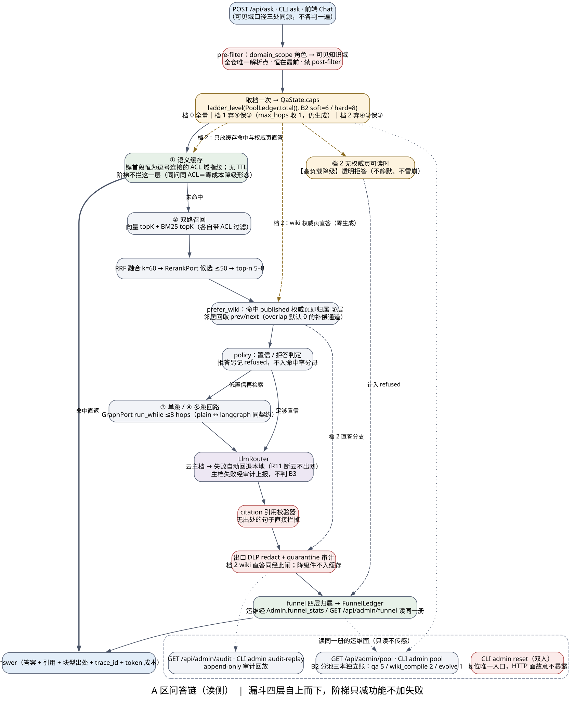
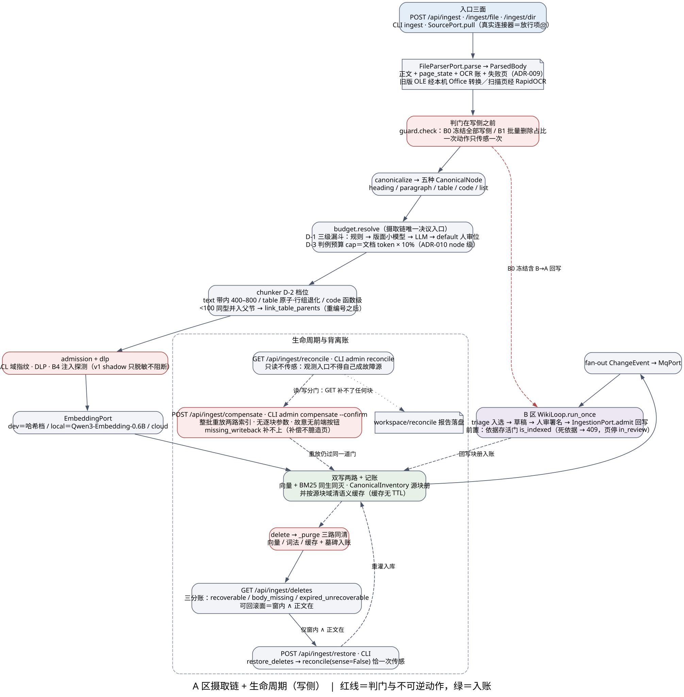

<div align="center">

# Agentic RAG + LLM Wiki

**企业知识库问答 + 人审知识页编译回路**

[](https://github.com/wuyuwuqiu666/agentic-rag-wiki/actions/workflows/ci.yml)
[](https://www.python.org/)
[](PRD-agentic-rag-llm-wiki.md)
[](#状态与边界)

[快速开始](#快速开始) · [架构总览](#架构总览) · [文档导航](#文档导航) · [提交记录](https://github.com/wuyuwuqiu666/agentic-rag-wiki/commits/master)

</div>

---

一套「企业知识库系统」的完整工程蓝图 + 单机可跑实现骨架：**Agentic RAG** 负责多跳检索、引用溯源与低置信拒答；**LLM Wiki** 负责把原始文档持续编译成人审发布的结构化知识页。

> **一句话定位**：架构按企业档（10 万员工 / 百万文档）设计，**执行档 = 单机缩量**（5 万文档 / 1 千变更每日 / ≤5 并发 / RTX 5060 8GB 全程可跑）。承诺只写在能亲手跑通的那一档；企业档与依赖真实世界输入的能力均按「诚实账」标注在放行清单里。
>
> **发布边界**：GitHub 仓库页发布源码、文档与架构图，不会直接运行 Python/FastAPI 后端。Web UI 需按下方步骤本地构建，并由 HTTP 门面同源伺服；本仓库不宣称已有云端演示或企业级在线服务。

## 核心特性

- **一切皆组件**：`providers/ports.py` 定义 15 个 Provider Protocol；dev / local / cloud 多实现并存，组合根唯一注入，换实现只改装配，业务代码零 SDK import。
- **Agentic RAG**：ACL pre-filter → 语义缓存 / 权威页优先 → 向量 + BM25 双召回 → RRF(k=60) 融合 → rerank（≤50 候选）→ top-n 5–8 进 LLM；逐句引用校验、无据句拦截、低置信拒答、步数预算 ≤8。
- **LLM Wiki**：triage 入选判定 → 大纲 / 草稿 → 人审发布门（草稿不可直发）→ 高权威块经 `IngestionPort` 回写索引；回写 ACL = 源块交集，封跨源泄露。
- **分层熔断 B0–B5**：判定（零 IO 纯函数）与执行分离，规则 YAML as-code；硬断双人复位，**重启不算复位**，append-only 审计回放。
- **护栏即代码**：10 道 harness 机检门覆盖 import 方向、跨区三禁、契约兼容、熔断规则、参数白名单、生命周期、配置面、后端选择、runbook 与依赖许可证。
- **诚实账**：默认 embedding / rerank / llm 为确定性哈希与模板回显，**不是模型质量基线**；真模型效果、真机性能、双存储持久化、外部源连接器与跨人治理流逐项登记，不伪造达标数字。

## 架构总览



**读图口径**：A / B / C 与 platform 都是逻辑容器，执行档默认单进程，不是五个独立部署单元；A 区是唯一索引写入者；虚线外部能力需显式装配，图中形状不代表已经上线。

### 一次提问如何得到答案



默认 `dev_echo` 只验证控制流与契约；真实模型质量需显式切到 local / cloud 档并另行评测。

### 完整流程与架构资产

<details>
<summary>展开完整问答链 SVG</summary>



</details>

<details>
<summary>展开完整摄取与生命周期 SVG</summary>



</details>

| 资产 | 用途 |
| --- | --- |
| [交互式架构 HTML](agentic-rag-wiki/docs/architecture/agentic-rag-wiki.architecture.html) | 下载后用浏览器打开；支持明暗主题、路径聚焦与导出 |
| [Structurizr DSL](agentic-rag-wiki/docs/architecture/agentic-rag-wiki.structurizr.dsl) | C4 语义源，7 个视图 |
| [架构理解指南](agentic-rag-wiki/docs/architecture/agentic-rag-wiki.architecture-understanding.md) | 新人建立心智模型、评审者核对声称与执法、运维定位入口 |
| [逐节点证据索引](agentic-rag-wiki/docs/architecture/agentic-rag-wiki.evidence.md) | 每个架构节点对应真实源码文件与置信档 |
| [视觉检查页](agentic-rag-wiki/docs/architecture/agentic-rag-wiki.architecture.visual-check.html) | 下载后本地打开；明暗主题、两种视口的架构截图核对 |

## 快速开始

### 1. 核心闭环（零外部服务）

```bash
git clone https://github.com/wuyuwuqiu666/agentic-rag-wiki.git
cd agentic-rag-wiki/agentic-rag-wiki

python -m venv .venv
# Windows PowerShell: .venv\Scripts\Activate.ps1
# macOS / Linux: source .venv/bin/activate

python -m pip install -e ".[dev]"
python -m pytest src/platform/breaker tests -q
```

默认 `Settings` 全为 dev 档，零依赖外呼即可跑通闭环。切真实档只改 `.env` 的 `APP_PROVIDERS__*` 装配位；选云档缺凭证、或非默认档缺驱动一律 fail-loud，**绝不静默回落**。

```bash
cp .env.example .env  # Windows: copy .env.example .env
```

`.env` 已被 Git 忽略；真实凭证只从环境变量读取，禁止写进代码、配置模板或日志。

### 2. Web UI（本地演示档）

```bash
python -m pip install -e ".[dev,http]"

cd src/platform/gateway/web
npm install
npm run build
cd ../../../..

python -m src.platform.gateway.http
```

浏览器打开 <http://127.0.0.1:8000>。该页面使用合成 seed 语料验证「答案 ↔ 出处 ↔ Wiki」联动，不是真模型质量演示，也未实现 SSO / LDAP 鉴权。

## 目录结构

```text
.
├── .github/workflows/ci.yml             # GitHub Actions：测试、护栏、覆盖率与密钥门禁
├── PRD-agentic-rag-llm-wiki.md          # 产品需求定义 v0.7.1（待 B1 评审）
├── R8-ingest-performance-design.md      # 企业档摄取性能参考设计（归档）
├── local-model-selection.md             # 本地模型选型调研
├── bench/                               # 本机基准脚本与结果
└── agentic-rag-wiki/
    ├── AGENTS.md                        # 全局约束与实机放行清单
    ├── pyproject.toml / .env.example    # 依赖装配表与配置模板
    ├── src/
    │   ├── platform/                    # types / config / providers / breaker / gateway / harness
    │   └── partitions/                  # ingest(A) / wiki(B) / memory(C)
    ├── docs/adr/                        # 架构决策记录
    ├── docs/architecture/               # C4 / 交互式架构 / 两条流程 SVG
    ├── docs/runbooks/                   # 熔断与运维处置页
    ├── hooks/                           # pre-commit / pre-release
    └── tests/                           # 76 个测试文件
```

## 文档导航

| 想了解什么 | 读哪里 |
| --- | --- |
| 系统目标 / 需求 / 验收口径 / 里程碑 | [PRD v0.7.1](PRD-agentic-rag-llm-wiki.md) |
| 全局工程约束 / 诚实账 / 22 项实机放行清单 | [AGENTS.md](agentic-rag-wiki/AGENTS.md) |
| 为什么这么设计、推翻过什么 | [ADR 目录](agentic-rag-wiki/docs/adr/) |
| 架构图怎么读 | [架构理解指南](agentic-rag-wiki/docs/architecture/agentic-rag-wiki.architecture-understanding.md) |
| 每个节点对应哪段代码 | [证据索引](agentic-rag-wiki/docs/architecture/agentic-rag-wiki.evidence.md) |
| 熔断 / 对账 / 高危动作怎么处置 | [Runbooks](agentic-rag-wiki/docs/runbooks/) |
| CI 具体执行哪些门 | [ci.yml](.github/workflows/ci.yml) |

## 状态与边界

### 本次发布前复核

| 检查 | 结果 |
| --- | --- |
| 全量测试 | **699 total · 697 passed · 2 skipped · 0 failed** |
| Lint / 类型 | `ruff` 通过；`mypy` 124 个源文件通过 |
| Harness | **10 / 10 门通过** |
| 前端构建 | `tsc + vite build` 通过 |
| 发布安全 | 跟踪文件与新增改动完成密钥、本机路径、运行产物扫描；发现项已清理 |

### 尚未冒充已交付的能力

- 真模型幻觉率、相关性、拒答率与真实用户质量结论。
- 企业档 PG / Milvus 双存储、跨进程共享账、S3 / Kafka 与真实 collection 别名。
- SharePoint / OA / 网盘 / Git 等真实源连接器与增量调度。
- SSO / LDAP、跨人审批分离、真实 ACL 归因与完整治理流。
- 真机 1 QPS、P95、首 token 与 72 小时稳定性数字。

完整口径见 [AGENTS.md](agentic-rag-wiki/AGENTS.md) §8「M4 实机放行项清单」。本仓库不伪造这些达标数字。

## 安全发布约定

- T1：凭证只走环境变量 + `.env.example`；日志脱敏；字面密钥提交即阻断。
- T2：外部输入先在 service 层经 types schema 校验，再进入纯净内核。
- T3：删除 / 覆盖 / 推送 / 外呼先确认 Git 基线、迁移方案与回滚点。
- T4：新依赖核对来源与许可证；禁止 `--no-verify` 类绕过。
- T5：真企业密级文档不入本机云出口；演示 / 开发语料只用公开或合成集。

## License

本仓库暂未包含 `LICENSE` 文件，**未声明开源许可证**。正式开源、再分发或商用前请先取得作者授权；PRD 当前状态为 **待 B1 评审**。
